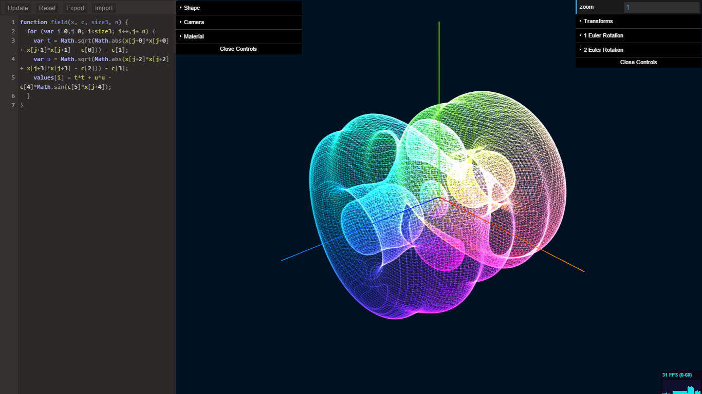

# IsoVis
Create higher dimensional shapes in a web browser.



## Run locally

Download or clone this repository, keeping `isovis.html`, `js/`, `lib/`, and
`css/` together. Serve the folder over local HTTP, for example:

```sh
python3 -m http.server 8000 --bind 127.0.0.1
```

Open http://127.0.0.1:8000/isovis.html in Chrome. On systems where Python is
named `python`, use that command instead. Any static HTTP server works; Bun's
optional `bun bench/serve.cjs` also serves the app at port 8080.

The app is plain browser JavaScript + pinned Three.js r187 ES modules:
**no Node, Bun, package installation, compilation, or build step is required
to use it** (the local server can be Python or any existing server).
Direct `file://` opening is no longer supported because browsers restrict ES
module loading. All libraries are local; no CDN or network fetch is required
once the files are downloaded.

**WebGL2 and browser import-map support are required.** There is no CanvasRenderer
or WebGL1 fallback. If WebGL2 is unavailable, an explanatory startup banner appears
before workers are created. Chrome is the primary verification target; other
browsers/devices have not been validated. The default branch is `main`.
See [the Three.js migration notes](docs/threejs_upgrade.md) for compatibility,
visual comparisons, and measurement limits. The previous r73 app remains in Git
at `23dc808140f973125b929bfec71bcae613ada32d` if an older device needs it.

### Tests and maintenance

Contributors can optionally install [Bun](https://bun.sh/) and run
`bun tests/run.cjs` from the repository root. Tests use small sequential fixtures
without third-party dependencies. See [tests/README.md](tests/README.md).

Correctness smoke tests and stable resource counters are not performance
benchmarks. Compare representative workloads, normals enabled/disabled, and
matching browser/hardware settings before claiming a speedup or changing the
hand-tuned marching-cubes traversal. Check upstream releases before modifying
vendored libraries; pin compatible versions and retain source/license details.
Three.js and its controls need a coordinated compatibility check.

First-party code follows snake_case for variables, functions, properties and
filenames, and CamelCase for types. See [naming conventions](docs/naming.md),
including third-party API and saved-session compatibility boundaries.

You can edit every parameter defining the shape in real time. Write your own JavaScript function & adjust "iso" to see different parts of the function. Scale, rotate, & translate through any dimension.

Runs on up to 9 cores. At maximum resolution (65) memory usage is ~1.2 GB. Press 'Abort' to reclaim.

Please report any bugs, and feel free to make feature requests.

## How to use IsoVis

I made an [impromptu introduction video](https://www.youtube.com/watch?v=JQlIhUtPM_w&feature=youtu.be) about IsoVis. It is imperfect; please ask any questions you have so I can address them for everyone's edification.

### What IsoVis does

This section contains technical jargon. You can skip ahead to the next section if you want.

IsoVis allows you to define any single-valued function (f: R^n → R, for any fixed n) and visualize where that function crosses some boundary value (the "isolevel"). Specifically, it allows you to apply an arbitrary linear projection A to your space, and see the portion of it that is projected into our familiar 3 dimensional space. 

This is implemented by taking a regular lattice around the origin and applying the *inverse* projection, then sampling the function. Thus, y = f(Bx) where AB=I and x is an n dimensional vector. Marching cubes is run on 8 background processes (one per octant), using the lattice of y values and the given isolevel.

Intermediate stages of the computation are cached to speed up performance, but memory use can be significant. Doubling the resolution increases memory use by a factor of 8.

### The Transformation Stack

The transformation stack is manipulated with the GUI windows on the upper right of the screen. Click on "Transforms" to expand it. Each transformation you apply is added one after another, from the bottom of the stack to the top. You can build any linear transform from these primitives.

* _Invert Order_ - Linear transformations are not commutative. (yaw left 90 degrees, then pitch up 90 degrees. Compare with doing that in reverse order) Click this to invert the stack of transformations. 

* _Push Transform_ - Adds a new transform to the top of the stack which you can manipulate.

* _Pop Transform_ - Remove the transform at the top of the stack.

* _Apply Transform_ - The entire combined linear transformation is computed, and your basis is changed such that this is the new Identity transform. This effect can be applied many times. In general use, you don't need to use this; it can make things confusing.

* _Pop All On Apply_ - Empties the stack when the above option is clicked. 

* _Reset Orientation_ - Removes the effect from "Apply Transform"

* _Pop All Transforms_ - Empties the stack. 

There are many types of primitive linear transformations. Because Javascript is 0 indexed, the first 3 dimensions are numbered 0, 1, and 2. Note that for technical reasons above the INVERSE of each linear transformation is what is actually applied. (read: contravariance and covariance)

* _Euler Rotation_ - Rotation on a plane defined by two basis axes. (Note, rotations happen on a plane, NOT around a direction; it only seems that way in 3 dimensions.) Because you can combine multiple rotations, you can generate any rotation by first projecting the desired rotation plane to be coplanar with two basis axes. 

* _Rodrigues Rotation_ - Not yet implemented. 

* _Clifford Rotation_ - Not yet implemented.

* _Lie Rotation_ - Not yet implemented. 

* _Scale_ - Values larger than 1 stretch the space, smaller values contract it. Negative values invert it. 

* _Translation_ - Positive move the scalar field "up" along that axis.

* _Shear_ - Applies the Identity transformation, but with a single user-specified off diagonal element non-zero. Note zero indexing and inversion of the shear amount.

* _General_ - Not yet implemented.

In contrast, the "zoom" field in the upper right applies a scaling that occurs after all other transformations. It is provided solely for convenience.

### The Function Editor

The pane on the left allows you to write code to define the scalar field you want to visualize. Change the width in the "Shape" GUI window using "editor_width". Set the number of dimensions you will be working in the same window with "dimensions". The "isolevel" field changes what value you are looking at.

* *Update* - Click to submit your changes to the Web Workers. *If you make an error, there will be no error message.* It will simply compile the default function instead.
* *Reset* - Resets the text editor. 

The other buttons in the same panel do not interact with your text editor (even import & export). 

Writing functions in the function editor is done by Javascript. The position of each point is stored consecutively in the x[] array, with an offset of j. Thus, to access dimension number k (again, dimensions are numbered starting at 0), you must access x[j+k]. Just remember to always add j to the index of x[]. This is done because x[] is a flat array, and IsoVis will use the for-loop to compute your function at each lattice point.

IsoVis expects that results are stored contiguously in values[]. Index into values[] with i, offset x[] by j, leave the for-loop alone, and IsoVis will take care of the rest.

    function field(x, c, size3, n) { // You can not edit this line.
      // Define any variables you might want.
      for (var i=0,j=0; i<size3; i++,j+=n) { // Do not edit this line.
        // Anything you want.
        values[i] = whatever_variable_holds_your_final_result; // Write output to the format IsoVis expects.
      } // Do not edit this line
    } // You can not edit this line.
    
If you wanted to look at a cylinder, you could accomplish that by:

    function field(x, c, size3, n) { 
      for (var i=0,j=0; i<size3; i++,j+=n) { 
        values[i] = Math.sqrt(x[j+0] * x[j+0] + x[j+1] * x[j+1]);
      } 
    } 

Note, when using the square root function, make sure you never pass it a negative value. The result will not be what you want. There is no support for complex numbers. Similar caveats apply to functions like logarithm, dividing by 0, etc. 

Maybe you wanted the cylinder to have a varying, periodic radius:

    function field(x, c, size3, n) { 
      var wiggle;
      for (var i=0,j=0; i<size3; i++,j+=n) { 
        wiggle = 1 + Math.sin( x[j+2] );        
        values[i] = Math.sqrt(x[j+0] * x[j+0] + x[j+1] * x[j+1] + wiggle);
      } 
    } 

Maybe you wanted to be able to control how the radius changed without applying transforms, so you add three constant coefficients (also 0 indexed):

    function field(x, c, size3, n) { 
      var wiggle;
      for (var i=0,j=0; i<size3; i++,j+=n) { 
        wiggle = 1 + c[0]*Math.sin( c[1]*x[j+2] + c[2] );        
        values[i] = Math.sqrt(x[j+0] * x[j+0] + x[j+1] * x[j+1] + wiggle);
      } 
    } 

These coefficients can be conveneintly edited under the "Coefficients" subwindow in the "Shape" window. You can change the number of coefficients by changing "coeff_count" right next to it. Having coeff_count set too high will not hurt things, but it might be confusing for the user.

If you wanted to use a coordinate system other than Cartiesian, such as spherical, you have to manually apply this conversion yourself. 

Everything we have done so far has been in three dimensions. We can easily define any function we want in any number of dimensions by just settings the "dimensions" field to the appropriate value, accessing x[j+3] or higher when computing values[], and applying 

### Other Features

The amount and speed of the camera bob can be changed in the "Camera" window in the GUI on the left side, under "radius" and "speed". The two fields just above this allow you to switch from projective to orthographic camera, and change the field of view.

The "Screenshot" button on the upper left takes a screenshot. Duh.

### Saved sessions

**Export** saves a versioned JSON session containing shape, camera, material and
transform settings, the transform stack, the applied base orientation, and the
**active submitted function source**. Click Update before exporting if you want
your current editor changes included: unsubmitted drafts are not saved.

**Import** restores that session, including the submitted function in the editor,
and rebuilds workers. Legacy array-of-groups files remain supported; because
they omit the base orientation and function, those omitted values reset to the
identity/default rather than inheriting an unrelated receiving session.

Treat session files as executable input: submitted JavaScript runs in workers.
Only import files/source you trust. Save a copy of your current session first.
Invalid settings should be corrected rather than bypassed. A failed calculation
reports an error; edit the function and click Update to retry. Abort terminates
an unresponsive calculation.

Under "Shape" the "memory_overuse" setting amortizes memory allocation for smoother operation. Decrease it for minimal memory use, but worse performance in the typical case.

The **Abort** button terminates and replaces the calculation workers and lowers
the resolution to 10. It keeps the active submitted function, not unsubmitted
editor edits. It does not cancel or undo edits to saved settings.

Material settings control wireframe/solid rendering, lighting and transparency.
Actual surface normals are calculated when enabled; this costs computation.
Disabled normal calculation does not supply useful lighting/normal colors, so
use an unlit material when normals are off. Large meshes may use a nonindexed
fallback if unsigned 32-bit element indices are unavailable.

## FAQ (aka, WTF's)

### WTF? Why is the main HTML file so huge? 

Security policy for web browsers makes this the easiest, safest way to use "Web Workers" (parallel processes) while hosting the code on your local computer. I wish I had an easy fix, sorry!

### WTF? Why are there global variables? 

This started off as a quick, one-off side project. I started off unfamiliar with how Javascript's "var" worked, and ended up making large portions of the core logic use global variables because that is the default behavior of new variables in function scope, for some reason. Whoops! This can be fixed (nothing is reliant upon them being global, per se), but it would be time consuming / slightly annoying so I haven't done it. 

## Experimental features and remaining limitations

- GIF/frame export is experimental and is not exposed as a supported GUI button.
  It downloads PNG frames rather than encoding a GIF. The built-in sequence
  expects two rotation transforms; it is not a general animation editor. Review
  the implementation before using console-driven `start_gif()`; `stop_gif()`
  cancels its capture/advance timers. Ordinary screenshots are separate.
- High resolution and higher dimensions can require substantial memory. Start
  small; historical memory figures above are not current measurements for every
  browser or hardware configuration.
- Mobile interaction, transparency/material combinations and cross-browser
  behavior need broader testing. A passing Chrome smoke test is not a guarantee.
- Presets, volumetric visualization and nonlinear transformations are potential
  future features, not implemented functionality.

Use [GitHub issues](https://github.com/csp256/IsoVis/issues) for the current defect
and improvement backlog rather than treating the historical bug list as status.

## Pull requests, suggestions, and use-cases welcome.

I would love to see what you made!
