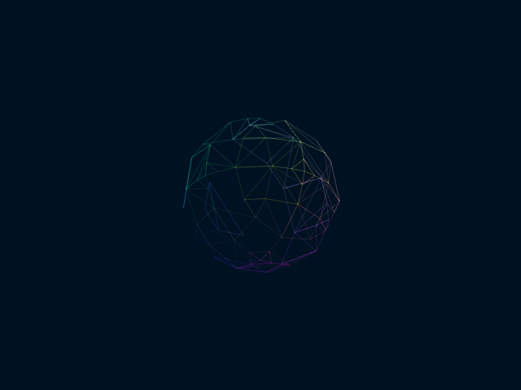
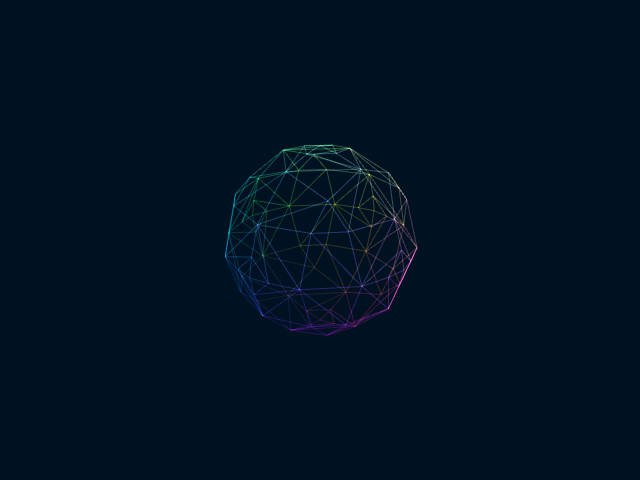
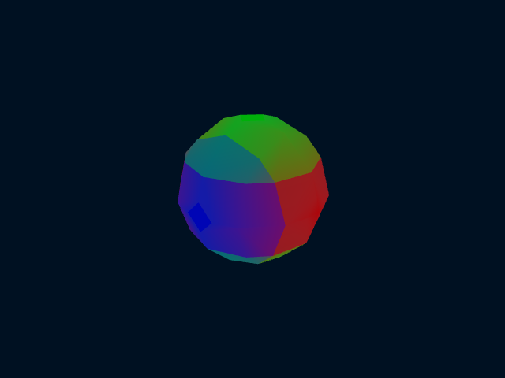
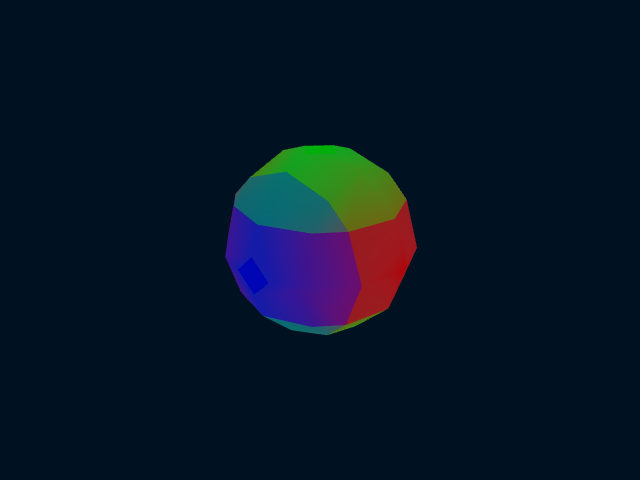

# Three.js r73 → r187

This is a renderer migration, not a math rewrite or a TypeScript/build-system
migration. Baseline: `23dc808140f973125b929bfec71bcae613ada32d` on `main`.
Upstream release: [r187](https://github.com/mrdoob/three.js/releases/tag/r187),
commit `7e89746a687bb88271253698fa108b1dd59825d0`.
See [the official migration guide](https://github.com/mrdoob/three.js/wiki/Migration-Guide).

## What changes

- Browser-native ES modules and an import map load local, pristine upstream
  module/core builds and matching OrbitControls. Existing application scripts
  use a narrow namespace bridge in `js/bootstrap.js`. No npm, Node, CDN, bundler,
  package installation, or app build is introduced. Bun remains optional tooling.
- **Local HTTP is now required.** Direct `file://` loading is not supported;
  the page displays a server instruction. See the README for Python/Bun options.
- **WebGL2 is required**, matching current Three.js. The obsolete Detector and
  CanvasRenderer branch are removed. A missing context produces a startup banner
  before editor/mesh/worker initialization; no workers are started.
- `setAttribute`, `AxesHelper`, modern controls and explicit keyboard listening
  replace obsolete APIs. Large meshes use core Uint32 element indices rather
  than querying a WebGL1 extension or expanding triangle lists.
- Geometry bounds are computed from active vertices, replacing the shared dummy
  sphere. This adds a small CPU pass and enables correct frustum bounds.
- Old Three.js/controls/Detector files are removed, not retained as a second
  runtime renderer. Their history remains available for old-device use.
- Upstream source and MIT license are unmodified. Exact sources and SHA-256
  checksums are recorded in `lib/three-r187/upstream.json` and tested offline.
  The r187 release ships unminified builds; approximately 2.1 MB of module/core
  source replaces the old single minified bundle. No local minifier is added.

## Preserve existing appearance deliberately

The application explicitly keeps the old unmanaged RGB / linear-output display
convention, disables tone mapping, and uses constant-distance point lights with
π intensity compensation for the modern BRDF. This avoids silently re-grading
backgrounds, Lambert/Phong shading, and saved sessions. This is intentionally not
a move to a new physically based color/lighting workflow.

Modern MeshDepthMaterial has a different display formula. The existing Depth
view is preserved with a small application-owned ShaderMaterial using the r73
near/far smoothstep formula, refreshed for the current camera and opacity. No
upstream shaders are patched.

**Wireframe edge coverage and brightness differ.** Do not promise pixel-identical
output. The current renderer shows more visible edges in the controlled fixture;
review the images below before merging. Solid material differences are much
smaller. Line rasterization/renderer behavior is not overridden to emulate r73.

### Controlled image comparison

Same headless Chrome 156 / SwiftShader, 640×480 canvas, resolution 8 sphere,
identity transform, fixed camera, no wobble or axes. The first case uses startup
normal-material/wireframe settings; solid cases use opacity 0.7 and normal
blending. Additional cases exercise custom blending and orthographic projection.
All eight cases have **identical per-octant index counts**, `[57,57,57,57,57,57,57,57]`.
PNG export succeeded; no shader-console or WebGL errors occurred.

| View | r73 | r187 |
|---|---|---|
| Normal wireframe |  |  |
| Solid Lambert |  |  |

RGB comparisons sample every third pixel in each dimension. Values below are
absolute 8-bit channel differences across the whole canvas, **not** perceptual
scores; whole-canvas averages dilute localized edge differences.

| Case | Mean absolute difference | Maximum difference |
|---|---:|---:|
| Normal wireframe | 0.5394 | 216 |
| Solid Basic | 0.0004 | 1 |
| Solid Depth (compatibility shader) | 0.0004 | 1 |
| Solid Lambert | 0.0454 | 3 |
| Solid Normal | 0.0012 | 1 |
| Solid Phong | 0.0011 | 1 |
| Custom additive blending | 0.0010 | 1 |
| Orthographic Normal | 0.0026 | 1 |

Wireframe non-background pixel counts are 7,991 → 10,582; each solid perspective
case covers 28,012 pixels on both versions. Summaries are in
[`threejs_results/visual_r73.json`](threejs_results/visual_r73.json) and
[`visual_r187.json`](threejs_results/visual_r187.json). The optional visual command
exports raw PNGs and sampled RGB arrays to JSON for independent comparisons.

## Performance comparison: inconclusive, no speedup claim

Runs were **sequential on the same host**, headless Chrome 156 with software
SwiftShader, resolutions 8/16, default field and sphere, normals off/on, one
warmup and three measured samples per case, 150 ms pauses. Workloads were small
to avoid monopolizing a shared development machine. Both reports contain the
same viewport/settings and source bodies. Raw distributions and metadata:
[`bench_r73.json`](threejs_results/bench_r73.json),
[`bench_r187.json`](threejs_results/bench_r187.json).

| Field | Resolution | Normals | r73 round-trip p50 (ms) | r187 p50 (ms) |
|---|---:|---|---:|---:|
| Default | 8 | Off | 2.1 | 4.0 |
| Default | 8 | On | 1.6 | 1.7 |
| Default | 16 | Off | 2.3 | 2.6 |
| Default | 16 | On | 2.7 | 3.9 |
| Sphere | 8 | Off | 1.6 | 1.4 |
| Sphere | 8 | On | 1.0 | 1.0 |
| Sphere | 16 | Off | 2.9 | 2.0 |
| Sphere | 16 | On | 1.9 | 2.2 |

Results are mixed, with several higher latencies in r187. Main-thread reply
handling p50 is 0.4–0.6 ms in r73 and 0.4–0.8 ms in r187. This small noisy run
**does not establish a speedup, performance parity, or hardware-GPU regression
clearance**. Round-trip latency does not measure completed GPU work. Modern bounds
calculation adds CPU work; modern render initialization and draw paths also differ.
Run the interactive benchmark on representative real hardware before making
performance claims. Maximum resolution and mobile GPUs were not stress-tested.

## Verification and reproduction

Run from the repository root, one command at a time:

```sh
bun tests/run.cjs
bun tests/browser_smoke.mjs
bun tests/browser_smoke.mjs --unsupported
bun tests/browser_smoke.mjs --visual --report visual_r187.json
bun tests/browser_smoke.mjs --benchmark --report bench_r187.json
```

The optional browser driver requires an installed desktop Chrome. Use
`--chrome "path/to/chrome"` or `CHROME_PATH` if the default executable is not
available. It starts a loopback-only server and a temporary headless profile,
uses a dynamically allocated debugging port, and stops Chrome/server afterward.
It intentionally uses SwiftShader for repeatability, **not hardware-GPU testing**.
No browser download or package installation is performed. Browser runs are not
added to CI; the existing sequential Bun workflow runs the unit suites (29 at the migration commit; additional naming tests were added later).

The saved r73/r187 measurements predate the naming cleanup. To reproduce that
historical comparison, use its original driver and fixtures from the migration
commit (they use the old application globals and old filenames):

```sh
git worktree add --detach ../isovis_comparison 775e09351b75d7233bb33c7af0c56d4d7918b19f
cd ../isovis_comparison
git worktree add --detach ../isovis_r73 23dc808140f973125b929bfec71bcae613ada32d
bun tests/browser-smoke.mjs --root ../isovis_r73 --visual --report visual_r73.json
bun tests/browser-smoke.mjs --root ../isovis_r73 --benchmark --report bench_r73.json
```

Historical report JSON is retained verbatim, including its original camelCase
metadata keys. Current benchmark reports use snake_case names. Current driver
commands above target the renamed app, not the r73 baseline.

Checks cover actual worker buffers and Abort/recovery, all-or-nothing partial
failure handling, saved sessions and dimensions, invalid GUI/import input,
short-coefficient defaults, large Uint32 GPU draws, repeated GUI/camera teardown,
solid rendering, real pointer orbit and wheel zoom, and orthographic rendering
after resize. GPU geometry counts remain 9 across repeated updates; same-state
canvas/window/document listener counts remain stable. Unit tests additionally
exercise OrbitControls disposal during an active pointer drag and depth shader
uniform refresh. The simulated unsupported context starts zero workers.

### Remaining review / limits

- Review the visible wireframe difference and HTTP/WebGL2 support change.
- Manual touch, keyboard interaction while editing, and real-device/mobile/GPU
  performance still need broader coverage. Pointer/wheel paths were exercised;
  keyboard listener setup/teardown is tested, not an exhaustive input matrix.
- Only Chrome was exercised. No Firefox/Safari compatibility claim is made.
- Existing layout/editor behavior and the experimental GIF feature are not
  redesigned by this migration. No worker traversal/math optimization is bundled.
